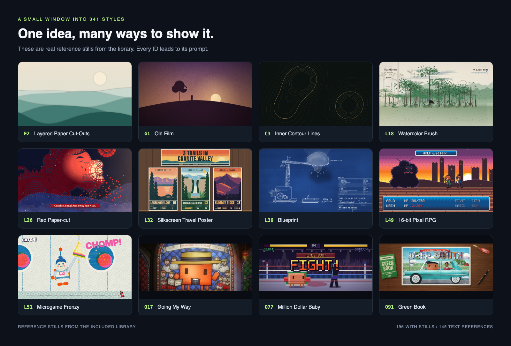
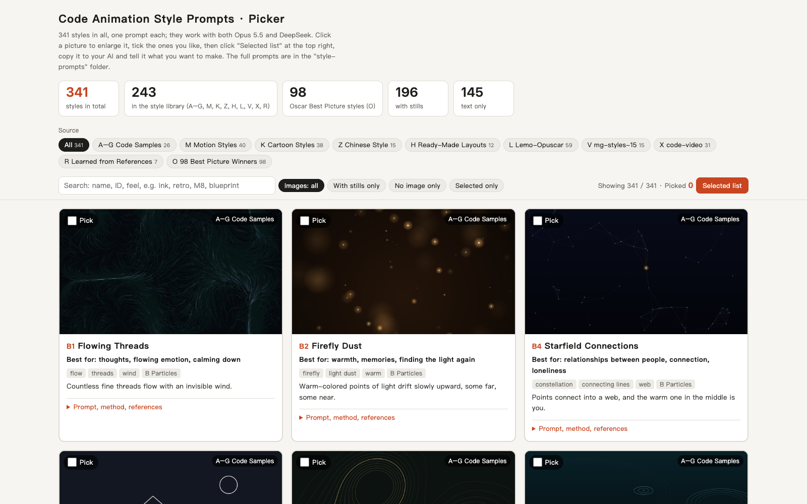
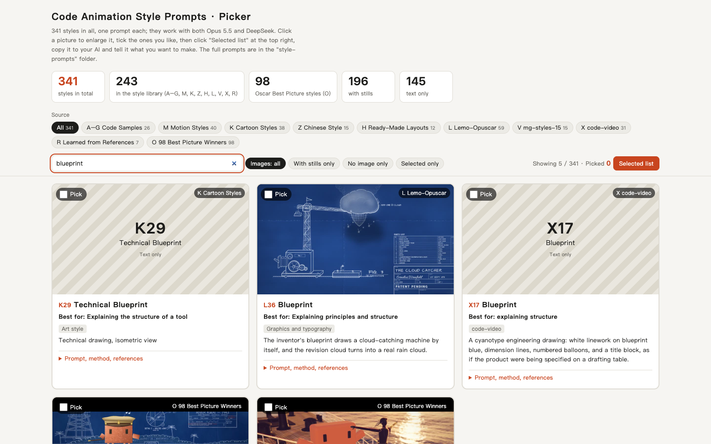

<div align="center">



# Code Animation Prompts

**From one creative idea to a code animation with real style.**

341 style prompts | 196 reference stills | 10 series | Claude Code & Codex skill

[](docs/STYLES.md)
[](docs/images/style-gallery.png)
[](skills/code-animation-prompts/SKILL.md)
[](LICENSE.md)

[Browse all styles](docs/STYLES.md) | [One-click import](#one-click-import-claude-code--codex) | [Manual install](docs/INSTALL.md) | [Original examples](skills/code-animation-prompts/assets/library/examples) | [Sources and licenses](LICENSE.md)

</div>

> **This is an unofficial, free English translation of [XiaoyeCodes/code-animation-prompts](https://github.com/XiaoyeCodes/code-animation-prompts).** Credit for the original project goes to upstream and to the sources listed in [LICENSE.md](LICENSE.md). This translation may not be sold or packaged for sale.
>
> About 20 to 25% of the reference stills and the B6 examples still show Chinese because they are original reference media.

## See the styles first

Particles, neon, ink wash, paper cutting, comics, cinematic looks and more. Hand the look you like to an AI assistant, then bring it to life with code.


These images come from the reference stills included with the pack, and their IDs match the prompts one to one. **196 have stills, 145 are text references**. Stills show a visual direction; the actual animation depends on your content, implementation and render.

| What you want to make | Where to start |
|---|---|
| Warm particle stories or intros | **B3** Particles Forming Shapes, **B2** Firefly Dust |
| Traditional Chinese-style intros or holiday shorts | **Z5** Chinese Paper Cutting, **Z1** Ink Wash, **Z8** Dunhuang Mural |
| Tech looks or cyber cities | **R1** Cinematic Neon Rain, **R5** Pixel Cyber Retro Game, **R6** Eastern Cyber Fantasy |
| Science or knowledge explainers | **M1** Hand-Drawn Whiteboard Explainer, **L10** Engineering Comparison Board |
| Comic shorts or high-impact pieces | **R3** American Comic Street Graffiti, **X7** Hero comic |
| Magazine-style layouts or film visual references | **H1** Biennale Yellow, the **O** series |

## What's included

| Component | What you can do with it |
|---|---|
| **Library and community additions** | Read 341 Markdown prompts and view stills, reference implementations and original examples |
| **Offline style picker** | Search, filter by category, enlarge images, tick styles and export a selected list |
| **Installable agent skill** | Let Claude Code or Codex read styles on demand, plan shots and build code animations |
| **Lightweight search script** | Look up by ID, keyword or series, without loading the whole library into context |
| **Browser render tool** | Export HTML that exposes a time interface to MP4 frame by frame, with optional existing audio |
| **One-click import prompt** | Paste it into Claude Code or Codex with local file and terminal access to download and install |

## One-click import: Claude Code / Codex

**Copy this whole block and paste it into Claude Code or Codex:**

```text
Install https://github.com/miolamio/code-animation-prompts as a skill available to the current coding assistant.

1. Download the repository to a suitable local directory. If a directory with the same name already exists, inspect its contents first and do not overwrite existing changes.
2. Read README.md, docs/INSTALL.md and skills/code-animation-prompts/SKILL.md.
3. Choose the install target for the current assistant: Codex uses ~/.agents/skills/code-animation-prompts,
   Claude Code uses ~/.claude/skills/code-animation-prompts.
   From the repository root, run python scripts/install_skill.py --target codex or --target claude.
   If you cannot determine the current assistant, ask me about the target only; do not install to both locations on your own.
4. Keep the complete skill folder when installing, including every prompt, still, HTML file, example video and license file in assets/library.
   If the target already exists, keep the existing directory and report it; do not delete or overwrite it automatically.
5. Run scripts/styles.py search ink from the installed directory to confirm styles can be found;
   then run scripts/styles.py show B3 to confirm a full prompt can be read.
6. Tell me the actual install path, how to invoke the skill, and whether I need to start a new session.
   Finally, give me one ready-to-use request for a "12-second particle-formation animation".

This task only installs the style skill. Do not automatically install video rendering dependencies, and do not change the configuration of other assistants.
```

You can also copy it from the [standalone import prompt](prompts/one-click-import.md). "One-click import" here means handing the whole request to a coding assistant to carry out; a regular web chat without local file access cannot install it for you.

<details>
<summary><b>Prefer to run the commands yourself?</b></summary>

You need Git and Python 3.10+. In a terminal, run:

```bash
git clone https://github.com/miolamio/code-animation-prompts.git
cd code-animation-prompts

# Install for Codex
python scripts/install_skill.py --target codex

# Or install for Claude Code
python scripts/install_skill.py --target claude

# Install for both
python scripts/install_skill.py --target both
```

The install script only copies files and downloads no extra dependencies. If a skill with the same name already exists, it stops and keeps the existing content. For project-level installs and copying without Python, see the [install guide](docs/INSTALL.md).

</details>

## Once installed, just ask

**Codex:**

```text
Use $code-animation-prompts to make a 12-second landscape animation with B3 Particles Forming Shapes.
The theme is "turning ideas into reality", showing three stages in order: inspiration, building, done.
1920x1080, 30 fps, dark background with warm gold particles, English captions, no sound.
Deliver editable HTML, keyframe previews and an MP4; if rendering dependencies are missing, say so clearly.
```

**Claude Code:**

```text
/code-animation-prompts Make a 12-second New Year intro with Z5 Chinese Paper Cutting, 16:9.
The text reads "A new year, full of promise", with red paper, cream rice paper and layered shadows.
Build editable HTML and keyframes first, with no sound for now; export an MP4 if the dependencies are available.
```

**Haven't picked a style yet:**

```text
Use code-animation-prompts to help me make a 30-second science short on "why it rains".
It's for primary school kids, vertical 9:16, with large captions and a warm, hand-drawn feel.
First give me 3 candidate styles with IDs, explain how each would move, then recommend one.
```

The skill provides style references and a production workflow; the video is still written by your coding assistant and rendered locally. Looking up styles needs no API key or paid image service. Usage costs for the assistant itself are set by its platform.

## Picking by eye beats describing



After downloading the full repository, double-click to open:

```text
skills/code-animation-prompts/assets/library/style-picker.html
```

It works offline in Chrome or Edge. Search by keyword or ID, tick styles, open "Selected list", copy it to your assistant, then add your topic, length, aspect ratio and sound requirements.

Keep it in the same position relative to `style-prompts/`. GitHub's file page only shows the HTML source; the picker works once downloaded and opened in a browser.

<details>
<summary>See the search screenshot</summary>



</details>

## See the animation in the original examples


*The excerpt above comes from the B6 example video in the pack and is a silent preview. The model labels in the original filenames come from the pack and do not mean this repository ran its own model comparison.*

| Example | Files |
|---|---|
| **B6 Warp Speed, Explosion, Reunion** | [Full prompt](skills/code-animation-prompts/assets/library/examples/B6_warp-explode-reunite_same-prompt/prompt.md) / [Original HTML and 2 MP4s](skills/code-animation-prompts/assets/library/examples/B6_warp-explode-reunite_same-prompt) |
| **X7 Hero comic** | [One-sentence prompt](skills/code-animation-prompts/assets/library/examples/X7_hero-comic_one-line-brief/prompt.md) / [Original HTML and MP4](skills/code-animation-prompts/assets/library/examples/X7_hero-comic_one-line-brief) |

**B6 is a standalone example and is not counted among the 341 style entries.** The 3 original MP4s, 3 example HTML files and process screenshots all ship with the repository.

## How the 341 styles are divided

| Series | Count | Focus |
|---|---:|---|
| A-G: Code Samples | 26 | Type, particles, line and ink, light and weather, shapes and paper, explainers, material feel |
| M: Motion Styles | 40 | How a whole video moves, cuts and tells its story |
| K: Cartoon Styles | 38 | The visual language of characters and the picture |
| Z: Chinese Style | 15 | Ink wash, gongbi, paper cutting, shadow puppets, Dunhuang and more |
| H: Ready-Made Layouts | 12 | Complete pairings of color palette and typeface |
| L: Lemo-Opuscar | 59 | Styles across many genres, each with a complete method |
| V: mg-styles-15 | 15 | Motion graphics styles |
| X: code-video | 31 | Code video styles |
| R: Learned from References | 7 | Cyberpunk and other visual references rendered in code |
| O: 98 Best Picture Winners | 98 | Film art-style references organized from the source pack |
| **Total** | **341** | **196 stills + 145 text references** |

[Open the full style index, where every entry is clickable](docs/STYLES.md)

## Export your own video

Finding styles, reading prompts and using the picker need no rendering dependencies. Only the included HTML-to-MP4 tool needs **Playwright + Chromium + FFmpeg**.

```bash
python -m pip install playwright
python -m playwright install chromium
ffmpeg -version

# Verify your setup with the included time-interface example
python skills/code-animation-prompts/scripts/render_video.py skills/code-animation-prompts/assets/starter/index.html --output output/demo.mp4 --duration 12 --fps 30 --width 1920 --height 1080
```

`ffmpeg -version` is a check; if FFmpeg is missing, see the [official FFmpeg downloads](https://ffmpeg.org/download.html). The renderer requires the page to provide `window.renderAt(t)` and to stop its real-time loop on `?export=1`. The original examples must be adapted to this interface first; it is not a general-purpose web page recorder. See the [render interface and audio notes](skills/code-animation-prompts/references/rendering.md) for details.

## Repository layout

```text
code-animation-prompts/
|-- README.md
|-- LICENSE.md                        # Sources and terms for each part
|-- prompts/one-click-import.md       # Import request to paste into Claude Code / Codex
|-- docs/
|   |-- INSTALL.md                    # Install locations, project installs, updates
|   |-- STYLES.md                     # 341 clickable entries
|   |-- images/                       # README images: style gallery, project screenshots, animated preview
|   |-- translation/                  # Glossary, path map, media notes, Chinese-text allowlist
|   `-- source-manifest.json          # Fixed SHA-256 baseline for the library
|-- scripts/                          # Install, index generation, preview generation, validation
`-- skills/code-animation-prompts/
    |-- SKILL.md                      # Skill entry point
    |-- agents/openai.yaml            # Codex display information
    |-- references/                   # Style index, rendering and source notes
    |-- scripts/                      # Search and video export
    `-- assets/
        |-- starter/index.html        # Added deterministic animation interface example
        `-- library/                  # Translated source material and registered community additions
            |-- style-picker.html
            |-- style-prompts/
            |-- examples/
            |-- third-party-licenses/
            |-- _stats.json
            |-- README.md
            `-- licenses-and-sources.md
```

## Credits and free-sharing terms

Thanks to the original curator, [**俯仰观照 (Fuyang Guanzhao)**](https://space.bilibili.com/3690990015613855/?spm_id_from=333.788.upinfo.detail.click) on Bilibili, for sharing these resources.

Thanks to [**Strange Leo (@strangeyu911-tech)**](https://github.com/strangeyu911-tech), who contributed the K1-K3 reference cards through [PR #1](https://github.com/XiaoyeCodes/code-animation-prompts/pull/1). The current 196 reference images are the 193 from the original pack plus the 3 community additions; the [sources and change notes](skills/code-animation-prompts/references/attribution.md) install with the skill.

Thanks also to **LemoLab (Lemo-Opuscar)**, **Vincentwei1021 (mg-styles-15)** and **Bae-ChangHyun (code-video)**. [XiaoyeCodes](https://github.com/XiaoyeCodes) added the skill packaging, tool scripts and project docs on top of the source material. This fork translates the prompts and docs into English; the third-party license files are unchanged, and changes to the picker, the stats and the added material are recorded separately.

**Free to use, free to share. Do not package this collection as a paid course, paid skills or anything else sold for money.** Third-party content stays under its own license; see [Sources and licenses](LICENSE.md). This repository does not relabel all material as MIT.

---

<div align="center">

**Pick a style, write your story, and let the code move.**

If this project helps you, a star is welcome, and so is sharing your code animations. Before contributing images, please read the [contribution guide](CONTRIBUTING.md).

</div>
